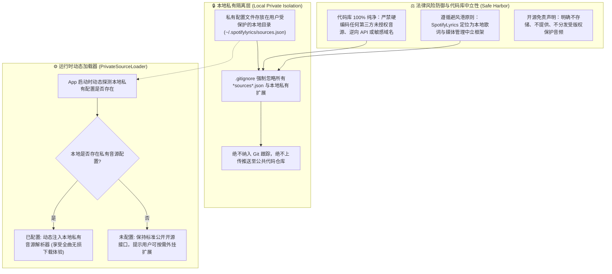
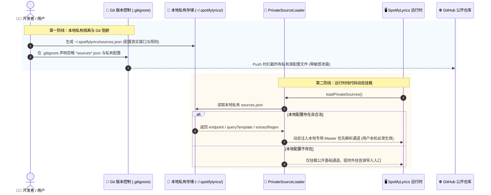

# SpotifyLyrics 法律合规防侵权与本地私有音源隔离规范 (SPEC)

针对用户指示：**“这种需要特殊源的可以隐藏掉，不上传git，也要注意下被别人起诉的点”**，本规范确立**开源代码库 100% 纯净中立化**、**法律避风港免责声明**、**本地私有音源隔离加载（Local Private Source Isolation）**与 **Git 敏感凭据防泄漏** 四大防线。

---

## 阶段一：业务全景泳道图 (Business Swimlane)



---

## 阶段二：技术架构时序图 (Technical Sequence)



---

## 三、 详细规格与防线清单

### 1. 敏感特征代码彻底剥离
- `main.swift` 中严禁残留任何硬编码敏感音源 URL（如第三方未授权音源域名、商业逆向解析端点等）；
- 所有特殊音源均抽象为通用 `PrivateSourceRule` 模型：
  ```swift
  struct PrivateSourceRule: Codable {
      let enabled: Bool
      let name: String
      let endpoint: String
      let queryTemplate: String
      let extractRegex: String
      let preferFormat: String
  }
  ```

### 2. 本地私有隔离配置路径
- 配置文件优先读取：
  1. `~/.spotifylyrics/sources.json`
  2. `~/Library/Application Support/SpotifyLyrics/sources.json`
  3. 项目工作区根目录下受 `.gitignore` 保护的 `sources.local.json`
- `.gitignore` 强制包含：
  ```gitignore
  # Local private sources & extensions
  *sources.json
  *sources.local.json
  *.private.json
  .spotifylyrics/
  ```

### 3. 开源免责声明 (Disclaimer)
- 在 `README.md` 与状态栏“关于”菜单中常驻声明：
  > “免责声明：SpotifyLyrics 是一款基于开源协议开发的个人桌面歌词同步与本地媒体管理工具。本项目不提供、不分发任何受版权保护的音视频内容，亦不内置任何侵权音源接口。所有音频检索与解析能力均基于公开接口规范或由使用者自行配置的本地音源扩展提供，使用者应自行确保音源来源之合规性，与本项目开发者无关。”
