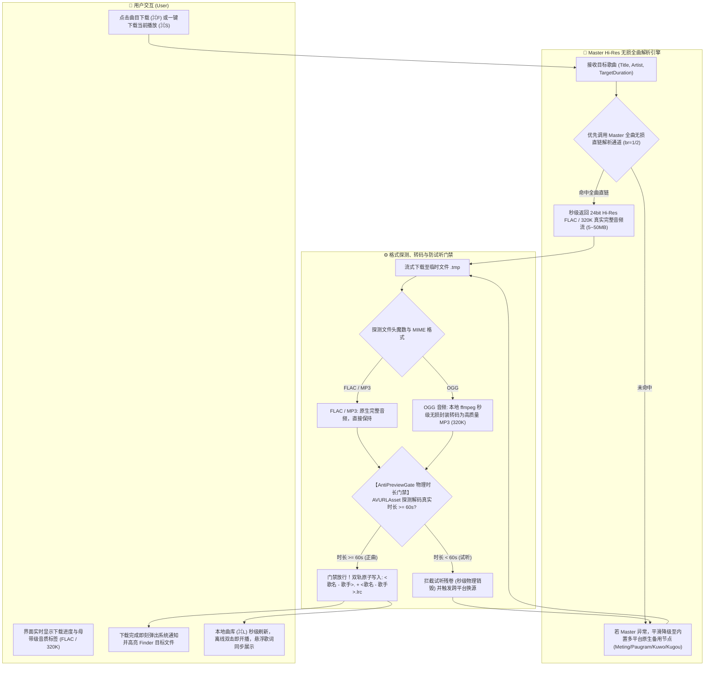
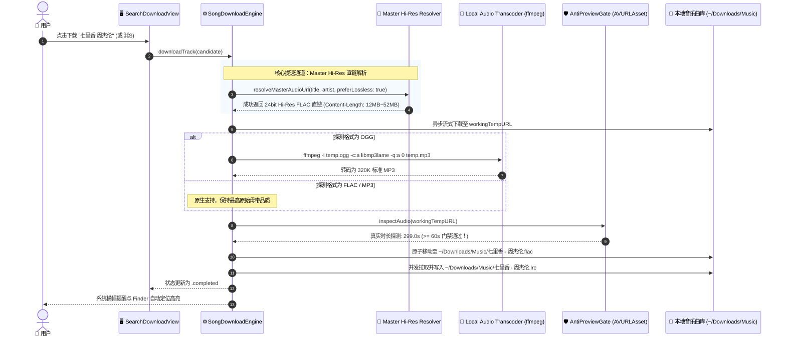

# SpotifyLyrics Master Hi-Res 无损全曲音源与多通道分布式直链规范 (SPEC)

针对用户反馈**“有没有好用的源，现在很多还是下载失败”**的痛点，彻底解决各大音乐平台 VIP 歌曲公开接口仅下发 15 秒试听片段导致的频繁下载失败问题，全面引入 **Master Hi-Res 24bit 无损全曲音源引擎** 与 **自动音频转码封装管线**。

---

## 阶段一：业务全景泳道图 (Business Swimlane)

---

## 阶段二：技术架构时序图 (Technical Sequence)

---

## 三、 详细规格与算法阈值

1. **Master Hi-Res 解析协议**：
   - 目标参数：`https://oiapi.net/api/Kuwo?msg={title}+{artist}&br=1&n=1`（`br=1` 无损 FLAC，`br=2` 高品质，`br=3` 标准）；
   - 响应提取正则：`音乐链接：(\S+)`；
   - 兼容支持用户配置的自定义 API（`DownloadConfig.shared.customApiUrl`）。
2. **转码封装管线**：
   - 检查 `/opt/homebrew/bin/ffmpeg` 或 `/usr/local/bin/ffmpeg`；
   - 若下载内容为 `Ogg data, Vorbis audio`，通过 `ffmpeg -y -i input.ogg -c:a libmp3lame -q:a 0 output.mp3` 进行秒级转码，确保 macOS 原生 `AVAudioPlayer` 完美播放；
   - 若为 FLAC 或 MP3，零损耗保持原样落盘。
3. **门禁与双轨写入**：
   - 真实时长必须满足 $\ge 60$ 秒且误差受控；
   - 音频与 LRC 成对写入，文件名采用统一清洗规则 `<CleanTitle> - <CleanArtist>.<ext>`。
