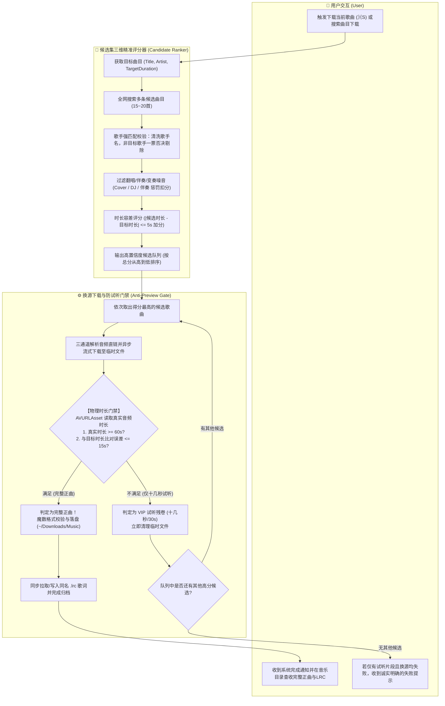
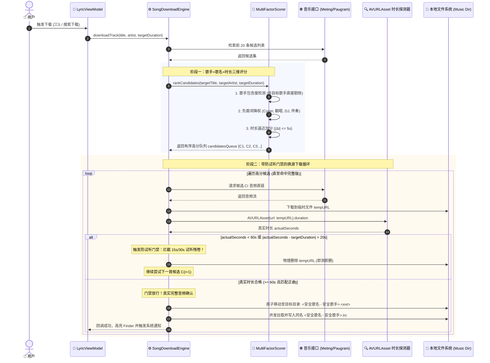

# SpotifyLyrics 音频防试听门禁与精准歌手匹配规范 (SPEC)

本文档针对**“下载仅十几秒试听片段”**与**“歌名对上但歌手不符”**的痛点，制定**音频真实时长物理门禁**、**歌手+歌名+时长三维置信度评分匹配**与**候选换源自动重试**的完整技术规范。

---

## 阶段一：业务全景泳道图 (Business Swimlane)

---

## 阶段二：技术架构时序图 (Technical Sequence)

---

## 三、 详细规格与算法阈值

### 1. 歌手与候选集评分公式 (Multi-Factor Scoring)
- **歌手纯净相似度 (Artist Score, 满分 50 分)**：
  - 清洗规则：去除 `(`、`)`、`feat.`、`ft.`、`with` 后缀，转小写与简体；
  - 匹配判定：若目标歌手完全出现在候选歌手字段中，得分 `50`；
  - **白名单一票否决制**：若候选歌手列表与目标歌手没有任何交集（例如目标为“周杰伦”，候选为“翻唱小周”），得分为 `-999`，**直接从候选队列中丢弃**。
- **歌名纯净度与负面标签过滤 (Title Score, 满分 30 分)**：
  - 目标歌名与候选歌名完全一致：`30` 分；
  - 负面词过滤：若目标曲名本身不含“翻唱/伴奏/cover/dj”，而候选词包含以下词汇：
    - `["翻唱", "cover", "伴奏", "inst", "instrumental", "dj版", "钢琴版", "吉他版", "remix", "纯音乐"]`
    - 每命中一个强扣 `30` 分，确保原唱正版排在最前。
- **时长逼近评分 (Duration Score, 满分 20 分)**：
  - 时长差 $|D_{cand} - D_{target}| \le 3$ 秒：`20` 分；
  - 时长差 $\le 8$ 秒：`10` 分；
  - 时长差 $> 30$ 秒：`-30` 分。
- **入选门槛**：仅总分 $\ge 60$ 分的曲目才允许进入下载尝试队列。

### 2. 真实音频物理时长门禁 (Anti-Preview Gate)
- **判定时机**：文件下载完成后、重命名归档前；
- **判定方法**：使用 `AVURLAsset(url: tempURL)` 读取实际音轨物理时长；
- **判定规则**：
  1. **绝对下限**：`actualDuration >= 60.0` 秒（任何只有十几秒、30秒的残片一律拦截）；
  2. **相对容差**：若目标歌曲时长已知（$T_{target} > 30$ 秒）：
     - 要求 $|actualDuration - T_{target}| \le 18.0$ 秒（或时长比率在 $85\% \sim 115\%$ 之间）；
  3. **拦截动作**：若判定为试听残卷，立即执行 `FileManager.default.removeItem(at: tempURL)`，并自动进入下一首候选换源重试；
  4. **全试听兜底**：若所有公开源版本均只有试听残卷，向用户明确反馈错误，严禁以残卷充当完成。
