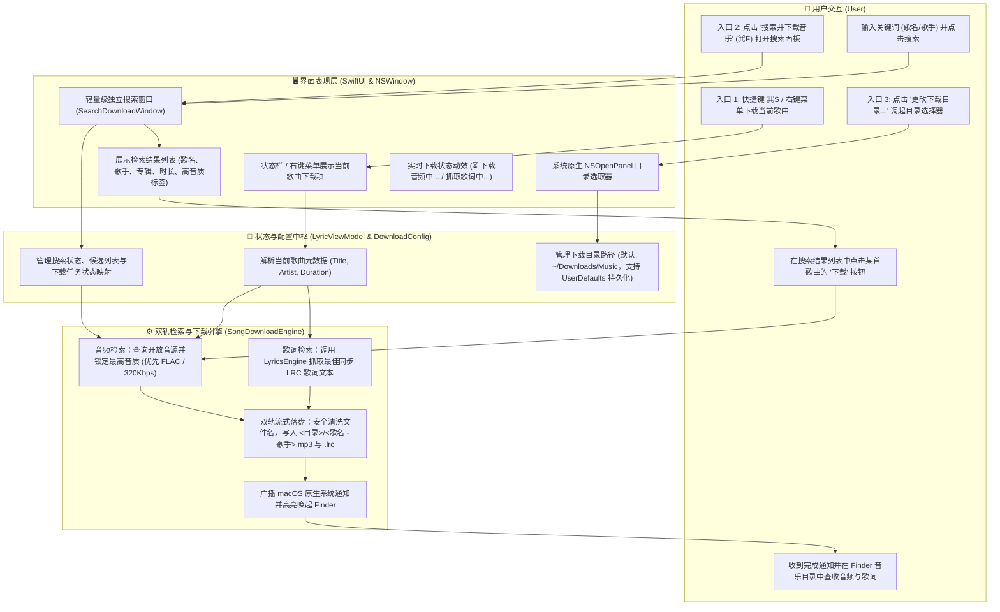
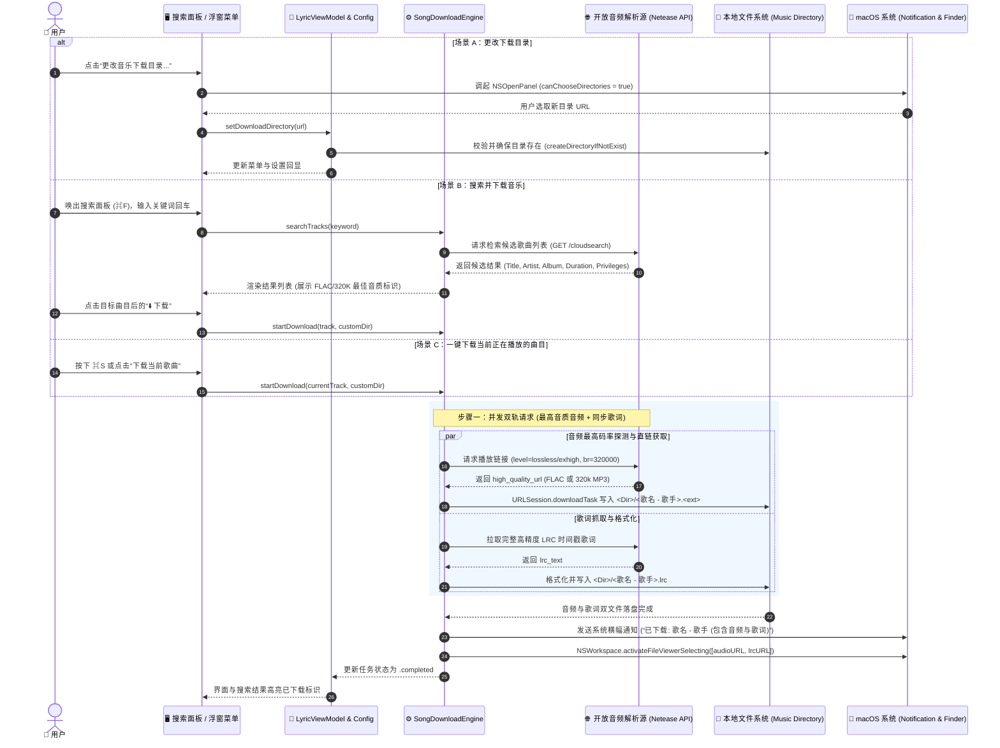

# SpotifyLyrics 音乐搜索、高品质音频与歌词同步下载规格规范 (SPEC)

本文档详细定义 SpotifyLyrics 音乐搜索检索、最高音质音频与同名 LRC 歌词双轨下载、自定义下载目录管理的完整业务泳道与技术架构时序。

---

## 阶段一：业务全景泳道图 (Business Swimlane)

---

## 阶段二：技术架构时序图 (Technical Sequence)

---

## 三、 详细技术方案与规格细节

### 1. 下载目录管理规范
- **默认路径**：`~/Downloads/Music/`（自动创建）；
- **持久化 Key**：`UserDefaults.standard.string(forKey: "UserDownloadDirectory")`；
- **目录校验**：每次启动或修改时自动检查目录是否存在并具备写权限，不存在则自动执行 `createDirectory(at:withIntermediateDirectories:true)`；
- **菜单交互**：
  - `📁 当前保存目录: ~/Downloads/Music`（可点击在 Finder 中打开）；
  - `⚙️ 更改音乐保存目录...`（调起原生文件夹选择器）。

### 2. 最高音质检索与落盘格式
- **音质探测策略**：
  - 检索参数严格优先匹配 `level=lossless`（无损 FLAC）与 `level=exhigh`（320kbps 极高 MP3）；
  - 若解析得到的内容类型为 `audio/flac` 或文件直链后缀为 `.flac`，则自动保存为标准的 `.flac` 扩展名；
  - 若为 MP3 则保存为 `.mp3` 扩展名，绝不进行降采样有损压缩。
- **文件名规范化**：
  - 清洗特殊保留字符（`:`、`/`、`\`、`?`、`*`、`"`、`<`、`>`、`|`）；
  - 统一格式：`<安全歌曲名> - <安全歌手名>.<ext>`。

### 3. 同名 LRC 歌词同步落盘
- 在写入音频文件的同一目录下，同时写入同名歌词文件 `<安全歌曲名> - <安全歌手名>.lrc`；
- 采用 UTF-8 编码，包含 `[ti:]`、`[ar:]`、`[al:]` 以及毫秒级滚动时间戳，能够直接被各类车载播放器、本地播放器（如 IINA、VLC、Foobar2000）完美自动识别加载。

### 4. 独立原生搜索窗口 (Search & Download Window)
- **外观与尺寸**：宽 580px、高 480px 的毛玻璃沉浸式悬浮窗口，按 `ESC` 或关闭按钮可退出；
- **组件结构**：
  - **顶部搜索栏**：输入框自动对齐焦点，支持回车直接触发搜索；
  - **中间列表区**：展示搜索到的前 15~20 首结果，每行展示歌曲名、歌手、专辑、时长、品质标签（如 `320K`、`FLAC`）以及下载操作按钮；
  - **操作状态**：点击后按钮切换为旋转进度圈（`Downloading`），完成后变为绿色对勾（`✓ 已完成`）；
  - **底部状态条**：实时显示当前存储目录，并提供一键更改目录与打开文件夹链接。
