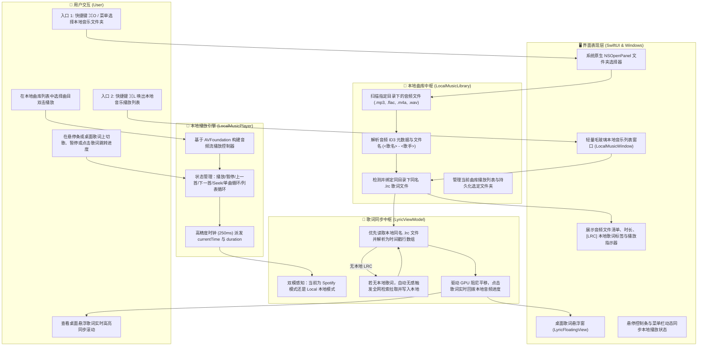
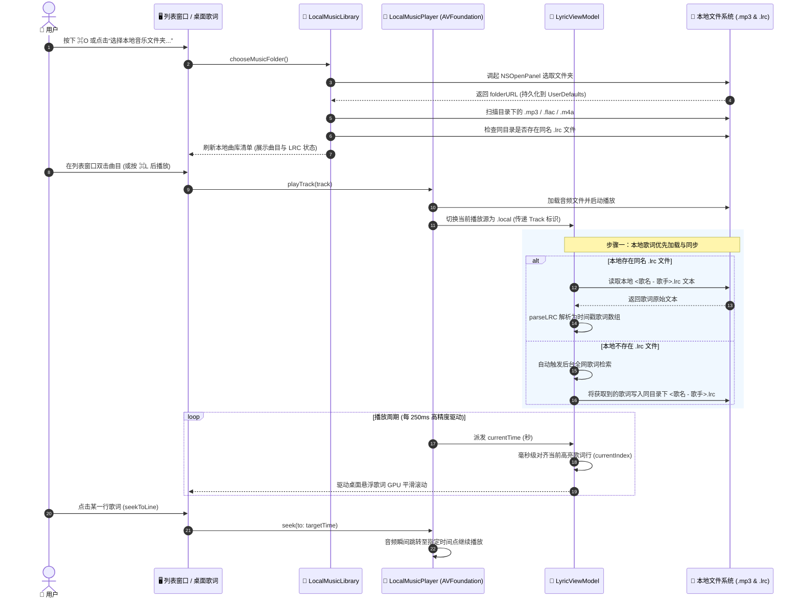

# SpotifyLyrics 本地音乐播放、曲库管理与本地歌词展示规格规范 (SPEC)

本文档定义 SpotifyLyrics 支持**本地音乐文件夹选择**、**本地音频播放引擎 (AVFoundation)**、**本地同名 LRC 歌词自动关联与展示**以及**本地曲库交互窗口**的完整业务泳道与技术实现时序。

---

## 阶段一：业务全景泳道图 (Business Swimlane)

---

## 阶段二：技术架构时序图 (Technical Sequence)

---

## 三、 详细技术实施方案

### 1. 本地播放引擎 (`LocalMusicPlayer`)
- **音频核心**：采用 macOS 原生 `AVAudioPlayer` / `AVPlayer`；
- **格式支持**：原生解码 `.mp3`、`.flac`、`.m4a`、`.wav`、`.aac`；
- **状态流转**：`isPlaying`、`currentTime`、`duration`、`currentTrackIndex`、循环模式（列表循环/单曲循环）；
- **悬停控制条联动**：当处于本地播放状态时，悬停控制胶囊上的 `⏮ ⏯ ⏭` 与双击单行折叠直接接管本地播放器。

### 2. 本地曲库与歌词自动对齐 (`LocalMusicLibrary`)
- **默认文件夹**：初始自动指向此前下载目录 `~/Downloads/Music`（用户无需重新配置，刚刚下载好的音乐即刻列出可播）；
- **本地同名歌词对齐规则**：
  - 音频路径：`/path/to/Music/晴天 - 周杰伦.mp3`
  - 自动寻找：`/path/to/Music/晴天 - 周杰伦.lrc`
  - 若存在直接读取，0 网络依赖，纯离线秒开；
  - 若缺失，自动后台无感调用 `LyricsEngine` 拉取并保存同名 `.lrc` 文件到同目录下。

### 3. 本地曲库管理窗口 (`LocalMusicWindow`)
- **交互规范**：
  - 快捷键 **`⌘L`** 呼出/隐藏；
  - 尺寸 600 × 520 毛玻璃沉浸设计，支持 `ESC` 退出；
  - 支持即时关键词搜索过滤曲库；
  - 列表项支持双击播放，标记 `[LRC]` 标识；
  - 底部集成播放控制栏（进度条拖拽、上一首、播放/暂停、下一首、音量控制）。
