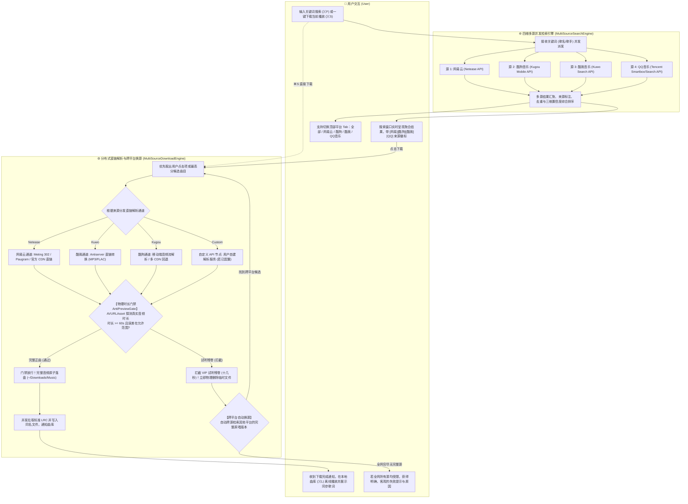
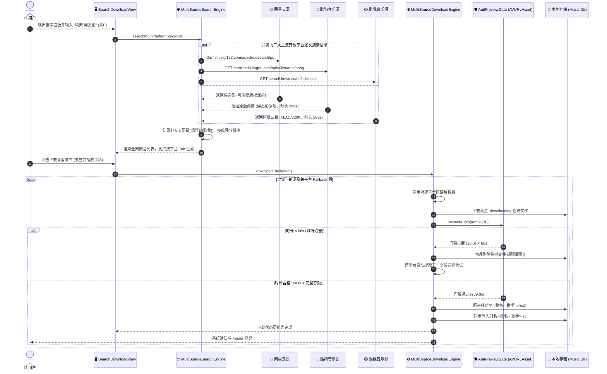

# SpotifyLyrics 全网四维多源聚合搜索与分布式跨平台直链下载规范 (SPEC)

针对用户反馈**“下载歌曲来源太少，好多都下载不了，甚至搜索不到”**的痛点，全面推行**全网四大主流平台并发聚合搜索**、**多源分布式直链解析**、**跨平台智能自动换源（Cross-Platform Fallback）**与**防试听物理时长门禁**技术方案。

---

## 阶段一：业务全景泳道图 (Business Swimlane)



---

## 阶段二：技术架构时序图 (Technical Sequence)



---

## 三、 详细规格与算法阈值

### 1. 平台枚举与元数据模型
```swift
enum MusicSourcePlatform: String, CaseIterable, Identifiable {
    case all = "全部"
    case netease = "网易云"
    case kugou = "酷狗"
    case kuwo = "酷我"
    case qq = "QQ音乐"
    
    var id: String { rawValue }
    var badgeColor: Color { ... }
}

struct SearchTrackItem: Identifiable, Equatable {
    let id: String           // 唯一标识 (例如 "netease_12345", "kugou_hash", "kuwo_rid")
    let numericId: Int       // 兼容纯数字 id
    let source: MusicSourcePlatform
    let title: String
    let artist: String
    let album: String
    let durationSeconds: Double
    let qualityTag: String    // "FLAC", "320K", "192K", "128K"
    let extraData: [String: String] // 存放 hash, album_id, rid 等解析参数
}
```

### 2. 多源并发搜索机制
- 使用 `DispatchGroup` 并发调度四大平台的搜索请求；
- 单个平台超时设置：`4.0s`，避免单源网络延迟拖慢整体响应；
- 各源结果合并时，优先展示通过歌手匹配与歌名精准度的高分项，打上对应平台彩色徽标；
- 在搜索界面顶部提供 `Picker("平台", selection: $selectedPlatform)`，可随时切换【全部】、【网易云】、【酷狗】、【酷我】。

### 3. 多平台直链解析与跨平台自动换源
- **网易云**：Meting 302 Location 捕获 ➔ Paugram 备用 ➔ 官方 CDN；
- **酷我**：`antiserver.kuwo.cn/anti.s?type=convert_url&rid={rid}&format=mp3&response=url`；
- **酷狗**：移动端直链 API 及 CDN 回退解析；
- **自定义 API**：支持在 `DownloadConfig` 中配置外部/自建解析 API 地址，享有最高解析优先级；
- **AntiPreviewGate 门禁保护**：所有下载的音频必须通过 `AVURLAsset` 物理时长校验（$\ge 60$ 秒且误差受控），试听残卷一律物理销毁并不中断流水线，自动无感触发跨平台换源轮询。
